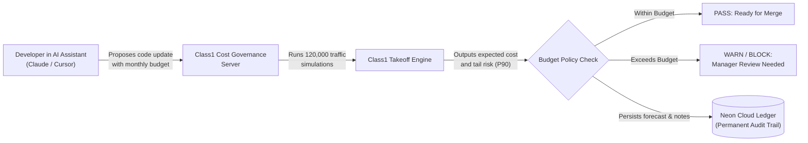

# Class1Dev AI Cost Governance Server: Business Use Cases

**Real-Time AI Cloud Cost Governance for Engineering & Finance Leaders**  
This server connects AI coding assistants directly to an automated cloud cost forecasting engine, allowing development teams to evaluate code changes against financial budgets in real time. By identifying potential cloud spend spikes before software is merged, it eliminates surprise infrastructure bills and records every financial decision in a permanent audit ledger.

---

## How It Works

---

## Exposed Tools & Business Capabilities

The server provides 10 purpose-built governance tools designed to prevent budget overruns, automate compliance, and maintain a permanent audit record.

| Tool Name | Primary Business Role | Key Outcome |
| :--- | :--- | :--- |
| `evaluate_pr_cost_risk` | Pre-Merge Cost Simulation | Predicts monthly cloud cost impact before code is committed. |
| `get_pr_governance_verdict` | Automated Compliance Check | Instantly verifies whether a code change passed or violated budget. |
| `log_budget_policy_override` | Executive Exception Ledger | Formally documents approved budget waivers with full accountability. |
| `get_governance_record` | Single-Record Audit Retrieval | Recovers exact historical cost forecasts and sign-off details for audits. |
| `list_governance_ledger` | Portfolio Spend Directory | Provides a centralized view of all active AI cost evaluations across teams. |
| `update_governance_record` | Workflow & Ticket Linking | Attaches change-management ticket numbers and approver notes to records. |
| `delete_governance_record` | Financial Ledger Hygiene | Purges temporary test estimates to ensure company reporting stays accurate. |
| `audit_pr_cost_history` | Cross-Team Cost Research | Searches past model upgrade costs to prevent duplicate benchmarking. |
| `get_finops_compliance_metrics` | Executive Health Telemetry | Delivers company-wide pass rates and budget compliance statistics. |
| `get_service_health` | Operational Reliability SLA | Confirms that the cost engine and database are live and responsive. |

---

## Tool-by-Tool Use Cases

### 1. `evaluate_pr_cost_risk`
- **Purpose:** Predicts the monthly cloud cost impact of an AI code change and checks it against a team budget.
- **The Problem It Solves:** Developers routinely increase token limits or switch AI models without knowing the price impact. These changes pass standard functional tests but result in multi-thousand-dollar billing surprises weeks later.
- **Realistic Use Case:** An engineer upgrading a customer-facing assistant from a lightweight model to a premium model checks the cost impact during code drafting, before submitting the pull request.
- **Example Prompt:** *"Evaluate the monthly cloud cost impact of my new code changes compared to the original code. Our team budget ceiling is $5,000 per month."*
- **Example Input & Output:**
  - *Input:* Original code vs. proposed code, target file name, monthly budget ceiling: $5,000.
  - *Output:* Expected Monthly Spend: $3,135; P90 Tail-Risk Spend: $6,403; Verdict: **WARN** (modeled risk reaches 80% of budget); Stored Record ID: `rec-4180`.
- **Business Benefit:** Prevents budget overruns before code is merged, stopping unexpected $5,000+ monthly cloud spikes.

### 2. `get_pr_governance_verdict`
- **Purpose:** Retrieves the budget compliance verdict (PASS, WARN, or BLOCK) and risk figures for a previously saved evaluation.
- **The Problem It Solves:** Reviewers and automated deployment systems cannot quickly determine whether a code change received financial clearance or requires management review.
- **Realistic Use Case:** An automated deployment pipeline queries the financial status of a pull request before allowing it to proceed into production staging.
- **Example Prompt:** *"What is the budget verdict and projected cost risk for evaluation record rec-4180?"*
- **Example Input & Output:**
  - *Input:* Record ID: `rec-4180`.
  - *Output:* Policy Verdict: **WARN**; Modeled Monthly Risk: $6,403; Allocated Budget: $5,000; Status: Requires Manager Sign-off.
- **Business Benefit:** Saves 2–3 hours of manual financial cross-checking per release and prevents unapproved spend from entering production.

### 3. `log_budget_policy_override`
- **Purpose:** Records an authorized budget exception or managerial waiver into the permanent financial audit ledger.
- **The Problem It Solves:** Emergency budget exceptions typically happen in unrecorded chat messages or verbal syncs, leaving finance teams with unexplainable invoice increases and zero audit defense.
- **Realistic Use Case:** A Product VP grants temporary financial headroom for a high-value client launch that exceeds the normal team budget.
- **Example Prompt:** *"Log an approved budget override for PR #301. Approved by Sarah Chen (VP of Product) for the Enterprise Client Launch with a temporary ceiling of $7,500."*
- **Example Input & Output:**
  - *Input:* Title: "PR #301 Budget Exception", Approver: "Sarah Chen", Justification: "Enterprise Launch", Approved Ceiling: $7,500.
  - *Output:* Status: SUCCESS; Stored Governance Record: `rec-9022`; Stored in permanent cloud audit ledger.
- **Business Benefit:** Provides 100% audit-readiness and clear executive accountability for every financial variance.

### 4. `get_governance_record`
- **Purpose:** Fetches the full historical record, notes, and approval trail of a specific cost evaluation or policy override.
- **The Problem It Solves:** When finance controllers question a historical budget variance, teams waste days tracking down who authorized it and why.
- **Realistic Use Case:** An internal auditor or finance controller inspects the original simulation parameters and executive approval notes for an earlier deployment.
- **Example Prompt:** *"Retrieve the full approval details, notes, and simulation data for record rec-9022."*
- **Example Input & Output:**
  - *Input:* Record ID: `rec-9022`.
  - *Output:* Full record showing initial cost estimate, simulated risk percentiles, approving VP, timestamp, and business justification.
- **Business Benefit:** Reduces corporate audit preparation and dispute resolution from days to seconds.

### 5. `list_governance_ledger`
- **Purpose:** Displays a chronological directory of recent cost evaluations, budget decisions, and active AI model updates across all projects.
- **The Problem It Solves:** Technology leaders lack visibility into upcoming AI infrastructure commitments across different development teams, making quarterly forecasting unreliable.
- **Realistic Use Case:** A Director of Engineering reviews all AI code changes evaluated over the past month to forecast next quarter's cloud infrastructure bill.
- **Example Prompt:** *"Show me the last 10 AI cost evaluations and highlight any that required budget waivers."*
- **Example Input & Output:**
  - *Input:* Show: 10 records, Order: Newest first.
  - *Output:* Summary list of 10 recent evaluations (8 Passed, 1 Warned, 1 Blocked) with associated projects and monthly dollar estimates.
- **Business Benefit:** Eliminates blind spots in AI spending, providing proactive visibility across the entire engineering portfolio.

### 6. `update_governance_record`
- **Purpose:** Attaches project management ticket numbers, review notes, or additional approvals to an existing cost record.
- **The Problem It Solves:** Technical code approvals happen in code repositories while business approvals occur in project management systems, leaving systems disconnected.
- **Realistic Use Case:** A release manager links a completed Jira ticket (JIRA-4820) and appends finance team approval notes to an existing evaluation record.
- **Example Prompt:** *"Update record rec-4180 to link Jira ticket JIRA-4820 and add note that the finance committee approved the variance."*
- **Example Input & Output:**
  - *Input:* Record ID: `rec-4180`, Ticket: "JIRA-4820", Notes: "Approved in Finance Weekly Sync".
  - *Output:* Update Confirmed; Ticket and notes attached to governance record in cloud database.
- **Business Benefit:** Unifies engineering pull requests, project management tickets, and corporate financial ledgers in one place.

### 7. `delete_governance_record`
- **Purpose:** Permanently deletes temporary local experiments, test evaluations, or retracted drafts from the system.
- **The Problem It Solves:** Throwaway test evaluations clutter company-wide dashboards and distort executive financial analytics.
- **Realistic Use Case:** An engineer removes an experimental test evaluation created while testing prompts locally before publishing a real pull request.
- **Example Prompt:** *"Delete the temporary test estimate record rec-test-8812."*
- **Example Input & Output:**
  - *Input:* Record ID: `rec-test-8812`.
  - *Output:* Confirmation: "Record rec-test-8812 permanently removed. System audit log updated."
- **Business Benefit:** Maintains clean, trustworthy financial reporting without accidental test data inflating company metrics.

### 8. `audit_pr_cost_history`
- **Purpose:** Searches historical records by keyword to discover what past model upgrades cost and how previous decisions were handled.
- **The Problem It Solves:** Engineering teams frequently duplicate costly research and benchmarking because they cannot easily find what other teams evaluated.
- **Realistic Use Case:** An engineering lead considering a transition to a faster model searches past evaluations to view previously simulated cost curves and recommendations.
- **Example Prompt:** *"Search our past cost evaluations for 'summarizer upgrade' or 'model migration'."*
- **Example Input & Output:**
  - *Input:* Keyword: "summarizer upgrade".
  - *Output:* 3 past evaluation records with monthly cost deltas ($3,100/mo avg), token usage notes, and final outcomes.
- **Business Benefit:** Prevents duplicate benchmarking, saving engineering teams weeks of redundant research and simulation time.

### 9. `get_finops_compliance_metrics`
- **Purpose:** Generates high-level executive statistics on company-wide AI governance activity, pass rates, and budget policy adherence.
- **The Problem It Solves:** Executives and board members lack measurable proof that engineering teams are following cloud cost governance guidelines.
- **Realistic Use Case:** The VP of Engineering prepares monthly board reporting showing that 95% of AI software changes launched on time and within budget.
- **Example Prompt:** *"Give me an executive summary of our AI FinOps metrics, total evaluations, and overall budget pass rates."*
- **Example Input & Output:**
  - *Input:* System-wide summary request.
  - *Output:* Total Evaluations: 142; Compliance Pass Rate: 91%; Approved Overrides: 9; Blocked Releases: 4.
- **Business Benefit:** Equips leadership with high-level confidence and quantitative governance data for board reporting.

### 10. `get_service_health`
- **Purpose:** Confirms that the cost evaluation engine, cloud database connection, and governance server are active and responsive.
- **The Problem It Solves:** Automated pre-merge checks can fail or delay software releases if underlying cloud infrastructure experiences silent outages.
- **Realistic Use Case:** A deployment platform verifies service readiness before running automated pre-merge cost checks.
- **Example Prompt:** *"Check the operational health and database connectivity of the cost governance service."*
- **Example Input & Output:**
  - *Input:* System diagnostic check.
  - *Output:* Operational Status: **HEALTHY**; Database Response Time: 14ms; System Uptime: 99.98%.
- **Business Benefit:** Guarantees 24/7 service availability, preventing developer pipeline bottlenecks and deployment delays.

---

## End-to-End Scenario: The Autonomous Cost Review & Approval

This walkthrough illustrates how the tools work together in a typical development lifecycle:

1. **The Code Change:** A developer updates a core AI service to improve response quality, increasing model capability and token limits.
2. **In-Editor Cost Check (`evaluate_pr_cost_risk`):** Inside their coding assistant, the developer asks for a cost estimate against their team’s $5,000 monthly budget. The engine simulates 120,000 traffic scenarios and forecasts a P90 tail risk of $6,403/month. The policy issues a **WARN** verdict and saves record `rec-4180`.
3. **Automated Pull Request Verification (`get_pr_governance_verdict`):** When the developer opens Pull Request #301, the automated code review system checks the stored verdict for `rec-4180`. Noting the **WARN** status, the system pauses the merge until financial approval is secured.
4. **Managerial Review & Exception Sign-Off (`log_budget_policy_override` & `update_governance_record`):** The Product Director reviews the business impact and approves the temporary $1,400 variance for the upcoming quarter. They record the executive waiver into the permanent audit ledger and attach Jira ticket `JIRA-4820`.
5. **Safe Merge & Executive Telemetry (`get_finops_compliance_metrics`):** With the formal waiver logged, the automated system clears the pull request for immediate deployment. Company leadership monitors the approval on the executive compliance dashboard, ensuring total transparency.

---

## Key Business Benefits

| Strategic Benefit | What It Delivers | Measurable Business Value |
| :--- | :--- | :--- |
| **Shift-Left Cost Visibility** | Informs developers of cloud costs *while writing code*, not weeks later on the monthly invoice. | Eliminates unexpected $10,000+ monthly cloud billing spikes before code ships. |
| **Tamper-Evident Risk Approvals** | Replaces informal chat approvals with a permanent, searchable cloud ledger. | Guarantees audit compliance and establishes clear financial accountability. |
| **Automated Pre-Merge Control** | Enforces team budget ceilings directly in continuous deployment pipelines. | Saves 3+ hours per release cycle by automating manual cost reviews. |
